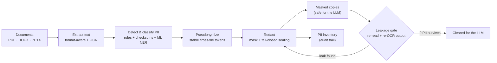
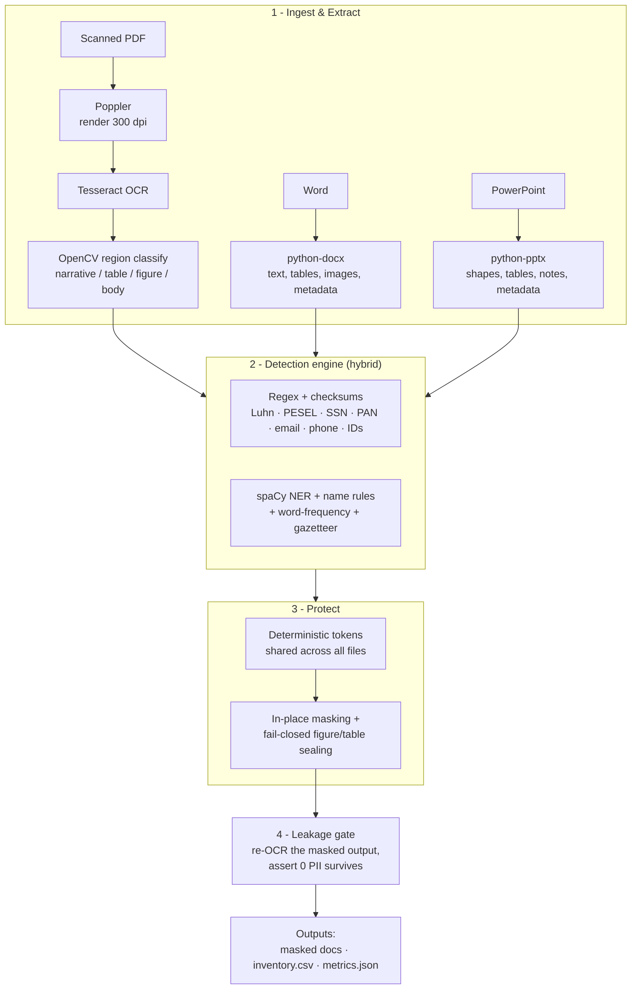

# Cadence PII Detection & Redaction — Full Summary (for building the deck)

_Optiv VIT Case Study 2. This doc has everything needed to build the PowerPoint: the story,
both diagrams, the numbers, honest limitations, and a slide-by-slide plan. The diagrams are
Mermaid — they render on GitHub, or paste them into https://mermaid.live to export a PNG for
the slides._

---

## 1. One-line summary
A repeatable, fully-offline system that strips Personally Identifiable Information (PII) out of
scanned PDFs, Word docs, and PowerPoints **before** they are sent to an AI document-analysis
agent — and then **independently verifies** that nothing leaked.

## 2. The problem (from the brief)
- **Background:** Cadence (a global financial firm) lets employees run business documents through
  an LLM "document analysis agent."
- **Policy:** PII must **never** reach the AI model.
- **So:** every document must be stripped of PII first — across varied, messy formats: a
  **scanned policy PDF**, a **Word training doc with screenshots**, and a **PowerPoint org pack**.
- **Targets:** near-100% PII coverage, minimal false positives, ≥80% of document structure
  preserved, and full traceability.

## 3. Our approach (one paragraph)
A **hybrid, fail-closed** pipeline. We extract text in a way tailored to each format (including
OCR for the scanned PDF), detect PII with a mix of **deterministic rules + checksums** (for
structured IDs) and **machine-learning NER** (for names), replace it with **stable tokens**, and
redact — **sealing whole regions we can't verify** (figures, dense tables). Finally, an
**independent gate re-reads and re-OCRs the output** to prove no PII survives.

---

## 4. Functional Design Diagram (data flow)
_Use on the "Solution Blueprint" slide._



## 5. Architecture Diagram (components & tech)
_Use on the "System Architecture" slide._



**ASCII fallback (if Mermaid won't render):**
```
 PDF ─ Poppler ─ Tesseract ─ OpenCV(region type) ┐
 DOCX ─ python-docx ───────────────────────────── ├─▶ DETECTION ─▶ TOKENS ─▶ REDACT ─▶ LEAKAGE GATE ─▶ OUTPUTS
 PPTX ─ python-pptx ───────────────────────────── ┘   (regex+checksums        (stable)   (mask +      (re-OCR,        (masked files,
                                                        + spaCy NER)                       seal regions) verify 0 leak)  inventory, metrics)
```

---

## 6. Extraction logic (per format)
| Format | How we extract | Why |
|---|---|---|
| Scanned PDF | Render 300 dpi → OCR every page → classify regions (OpenCV); figures & tables get a 2nd upscaled OCR pass | It's images, not text; context decides handling |
| Word (DOCX) | python-docx: paragraphs, tables, headers/footers, **metadata**; embedded images OCR'd | PII hides in tables, metadata, and screenshots |
| PowerPoint (PPTX) | python-pptx: shapes, tables, **speaker notes**, metadata | Notes & metadata are easy to miss |

## 7. Detection logic (hybrid)
- **Deterministic rules + checksums** for structured IDs: email, phone, employee ID, **SSN**
  (range+context), **India PAN**, **PESEL** (checksum), passport, TIN, **credit card (Luhn)**,
  masked card, account, DOB, home address, IP.
- **Machine learning + rules** for names: **spaCy NER** + name patterns (first-initial-last,
  initial+surname, period-less initials, plain First-Last) + a **word-frequency model** (tells a
  real surname from a common word) + a **gazetteer** that propagates every confirmed name across
  all three files.
- Every finding is tagged with **category, sensitivity tier, confidence, and the rule that caught
  it** → traceability.

## 8. Redaction — fail-closed
- **Normal text:** replaced in place with a token (`PERSON-016`, `EMAIL-002`) so surrounding
  context is preserved for the LLM.
- **Figures & dense tables:** **sealed whole.** OCR can render a name it never actually recognized
  as text, so we don't trust per-name masking there — we seal the region. Safety over appearance.
- Deterministic tokens are **shared across all three files**, so the same person is the same token
  everywhere (OCR variants merged).

## 9. The verification gate (the differentiator — emphasize this)
After redaction, an **independent gate re-opens the Word/PowerPoint text AND re-runs OCR on the
redacted PDF**, then asserts **no detected PII value survives in the output.** The first time we
ran it, it found a leak that our own review and **two rounds of external audit** had missed (an
email OCR had split around the `@`, and a name a table rendered that OCR never read). We fixed
them. *Don't trust the redactor — verify the output.*

---

## 10. Results (current, verified)
- **1002 distinct PII findings · 134 unique people · 67 figures/tables sealed · 0 residual leaks**
- By file: **PDF 826** (344 person, 177 employee-ID, 150 email, 135 phone, + SSN/PAN/passport/card/DOB…)
  · **DOCX 52** (names; its IDs/emails live inside sealed screenshots) · **PPTX 124** (56 person, 34 email, 34 phone)
- By sensitivity tier: **Critical 11 · High 9 · Medium 982**
- Gold-set recall **20/25 (80%)**; **effective coverage 25/25** (detected *or* sealed)
- **Generalizes** to an unseen document (`test_generalize.py`, 13/13); **26-check self-test** (`test_detect.py`)

## 11. Reliable outcomes
- Narrative/policy text is **preserved** (only PII is replaced); figures and PII-dense tables are
  sealed — a deliberate safety-for-utility trade.
- Masked PDF is image-only → **no recoverable text** under the redaction boxes.

## 12. Honest limitations (say these — it builds credibility)
1. **6 vector images (EMF/SVG)** can't be OCR'd → **flagged for manual review**, not silently passed.
2. Text-based redaction is bounded by **OCR quality** — which is *why* we seal unreadable regions
   and run the verification gate.
3. Recall is measured on a **self-authored gold set** — roadmap is a blind, independently-annotated corpus.
4. A tiny amount of **over-masking** (e.g., one place name) — the safe direction for a redaction gate.

## 13. Roadmap (name these as "next steps")
- Transformer NER backend (already wired: `--ner-model en_core_web_trf`) for stronger name recall.
- A "review-required" tier for uncertain detections.
- Blind, independently-annotated validation corpus for a credible recall number.
- Table-aware / vision-model OCR to reduce region sealing and preserve more structure.

---

## 14. Suggested slide deck (10–12 slides, ~12 min)
| # | Slide title | Content |
|---|---|---|
| 1 | Title | Case Study 2 — PII Detection within Text Artifacts · team names |
| 2 | The problem | Cadence background + "no PII to the LLM" policy (Section 2 above) |
| 3 | Solution blueprint | **Functional Design Diagram** (Section 4) + one-line flow |
| 4 | System architecture | **Architecture Diagram** (Section 5) + "hybrid + fail-closed" |
| 5 | Extraction logic | The per-format table (Section 6) |
| 6 | Detection logic | Hybrid: rules+checksums vs ML NER (Section 7); mention Luhn/PESEL |
| 7 | Redaction (fail-closed) | Token masking + region sealing (Section 8); before/after screenshot |
| 8 | Verification gate | The re-OCR gate + the leak it caught (Section 9) — **the highlight** |
| 9 | Live demo | Run `python pipeline.py`; show "gate PASSED"; open masked PDF + inventory.csv |
| 10 | Results | The numbers (Section 10) — a few big stats, not a wall |
| 11 | Reliability & limits | Structure preserved + honest limitations (Sections 11–12) |
| 12 | Close / roadmap + Q&A | Roadmap (Section 13) + thank you |

**Screenshots to capture for the deck:** (a) a masked PDF page showing tokens + a sealed
figure/table (e.g. page 6 or 28), (b) the terminal line "leakage gate PASSED", (c) a few rows of
`pii_inventory.csv` in Excel.

**The one message to land:** *"We didn't just build a redactor — we built one that verifies its
own output, and that verification caught real leaks."*
